# Databases — Week 1 Session Plan

> Adapted from the HackYourFuture Foundation Databases Week 1 session plan:
> https://program.hackyourfuture.dk/course-content/foundation/databases/week1/session-plan

## Session Materials

- **Database Diagram** — The diagram of the database to be created in this session.
- **Sample Tasks database** — Pre-created SQLite database with the contents of the sample SQL file.

## Session Outline

1. Introduction to Databases
2. Creating Your First Database
3. Interacting with Your Database

---

# 1. Introduction to Databases

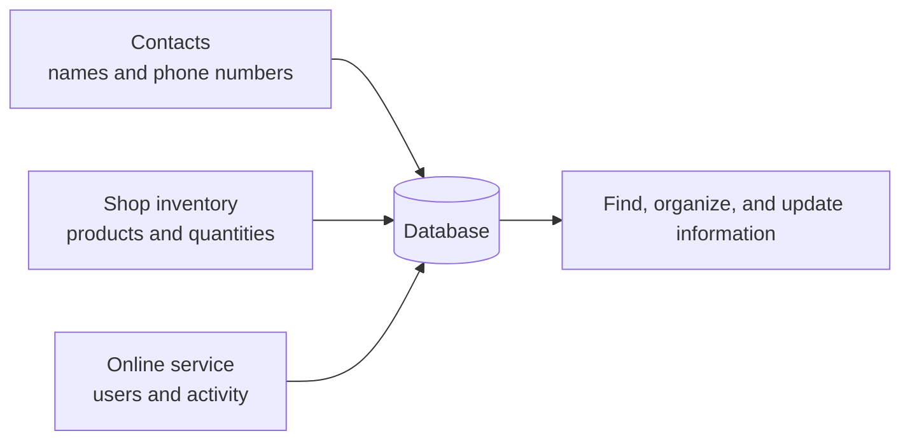

## What is a database?

A database is an organized collection of structured information, or data, typically stored electronically in a computer system.

Think of it as a digital filing cabinet where you can store, retrieve, and manage information efficiently.

## Real-Life Examples

### 1. Personal Use

- **Contact List:** Your phone's contact list is a simple database storing names, phone numbers, and email addresses.
- **Photo Library:** Your phone's photo app is a database organizing images by date, location, or album.
- **Excel Spreadsheets:** When you track monthly expenses or create a shopping list, you're essentially using a simple database.

### 2. Business Use

- **Inventory Management:** Stores use databases to track products, quantities, and prices.
- **Customer Records:** Businesses maintain customer information, purchase history, and preferences.
- **Employee Management:** Companies store employee details, attendance, and payroll information.

### 3. Everyday Services

- **Banking Systems:** Banks use databases to track account balances, transactions, and personal information.
- **Social Media:** Platforms such as Facebook and Instagram store user profiles, posts, and connections.
- **Online Shopping:** E-commerce sites use databases to manage product catalogs, customer orders, and shipping information.

## What do we gain from using a database?

1. **Organization** — Information is structured and easy to find.
2. **Efficiency** — Data can be accessed quickly.
3. **Data Integrity** — Databases help maintain accurate and consistent data.
4. **Security** — Access to sensitive data can be controlled.
5. **Scalability** — Databases can handle growing amounts of data efficiently.
6. **Reliability** — Data can be protected from loss or corruption.
7. **Shareability** — Multiple users can access the same data.

> Think of a database as a well-organized digital library where you can store and retrieve information quickly and efficiently, like a filing cabinet or spreadsheet, but with much more power and flexibility.

---

# 2. Databases in Software Architecture

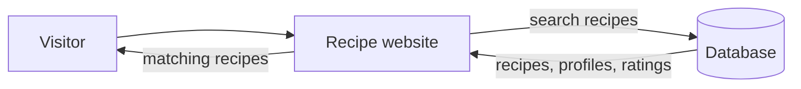

In modern software applications, databases serve as the backbone of data storage and management.

### Recipe website

Imagine a recipe website where users can share their favorite dishes.

The database can store:

- Recipes
- User profiles
- Comments
- Ratings

When someone searches for `"chocolate cake"`, the application queries the database to find relevant recipes.

### Movie streaming platform

A movie streaming platform can use databases to store:

- Movies
- User watchlists
- Viewing history
- User preferences

When a user logs in, the application retrieves their preferences and watch history.

### Blog

Even a simple blog needs a database to store:

- Articles
- Comments
- User information

Without a database, these applications would be like a library without a catalog: the information exists, but finding and managing it becomes difficult.

---

# 3. Database vs Database Management System

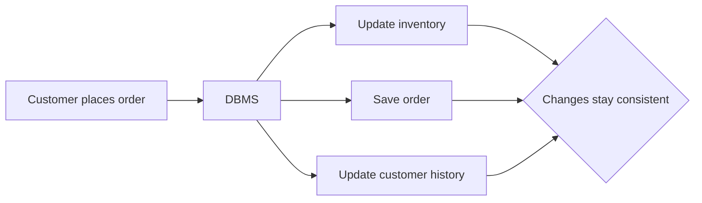

## Real-Life Example — Online Store

Imagine running an online store. You need to maintain data such as:

- Inventory
- Orders
- Customer information
- Order status
- Customer history

Now imagine that customer X places an order.

You may need to:

1. Update the inventory.
2. Check customer data.
3. Create or update the order.
4. Update the order status.
5. Update the customer's purchase history.
6. Send a confirmation.

What if this work could be automated and validated so that all records remain consistent?

This is where a **Database Management System (DBMS)** comes in.

### Without a DBMS

You might need to manually update separate spreadsheets for:

- Inventory
- Orders
- Customers

### With a DBMS

When someone places an order, the system can automatically:

- Update inventory.
- Create an order record.
- Send a confirmation email.
- Update customer history.

Think of a DBMS as a digital assistant that helps manage data efficiently, securely, and reliably.

## Popular DBMS Options

| DBMS | Often used for | Why |
|---|---|---|
| MySQL | Web applications, small-to-medium businesses | Free, reliable, widely supported |
| PostgreSQL | Complex applications, large datasets | Powerful features and complex query support |
| MongoDB | Applications with changing data structures | Flexible data model |
| SQLite | Small applications, mobile apps | Lightweight and requires little setup |

---

# 4. Creating Your First Database

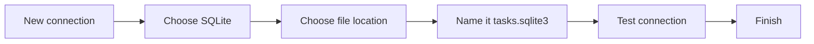

The goal is to create a database that can be used as a playground for learning SQL.

This will also allow us to explore:

- Tables
- Rows
- Columns
- Primary keys
- Foreign keys
- Data types
- SQL queries

## Step 1 — Create a New SQLite Connection

Using DBeaver:

1. Click **New Database Connection** in the toolbar, or press `Ctrl+Shift+N`.
2. Select **SQLite**.
3. Click **Next**.
4. In the **Path** field, click **Browse** and choose where to save the database.
5. Name the database file:

```text
tasks.sqlite3
```

6. Click **Test Connection** to verify that everything works.
7. Click **Finish**.

> See the DBeaver documentation for more information about SQLite connections.

---

# 5. Understanding Database Structure

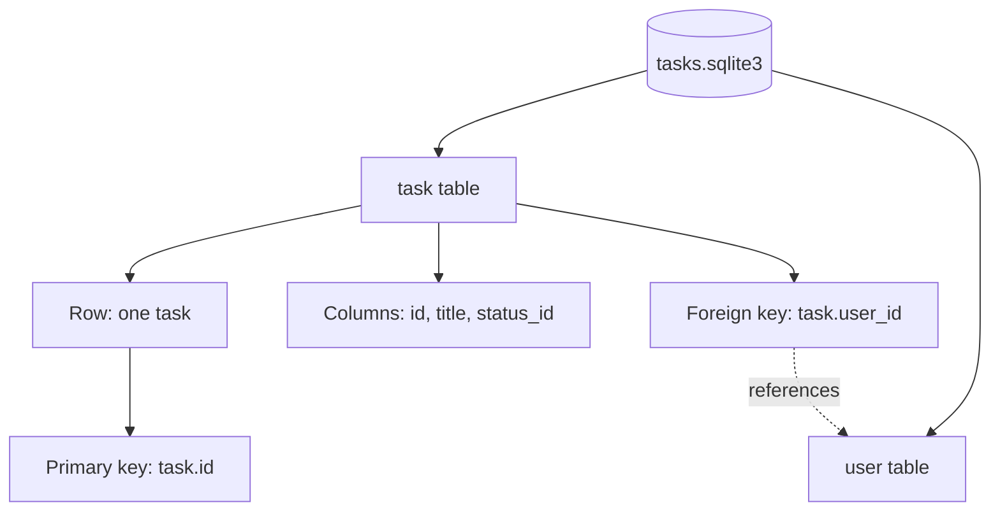

Before creating tables, understand the basic terminology.

## Database Terminology

| Term | Meaning |
|---|---|
| **Database** | The entire collection of related data |
| **Table** | A collection of related records |
| **Row / Record** | A single entry in a table |
| **Column / Field** | A specific piece of information in each row |
| **Primary Key** | A unique identifier for each row |
| **Foreign Key** | A reference to a primary key in another table |

A useful mental model is:

```text
Database
└── Tables
    ├── Rows
    │   └── Columns
    └── Relationships
        ├── Primary Keys
        └── Foreign Keys
```

---

# 6. Create Tables and Insert Sample Data

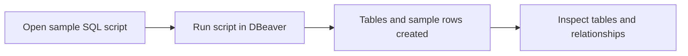

1. Find the sample SQL file in the session materials.
2. Copy the contents of the SQL file.
3. In DBeaver, right-click your database connection.
4. Select:

```text
SQL Editor → Open SQL Script
```

5. Paste the SQL commands into the editor.
6. Execute the complete script using the **Execute SQL Script** button or `Alt+X`.

After execution, you should have the sample Tasks database.

## Explore Your Database

Use the database diagram to understand the relationships between the tables.

---

# Exercise 1 — Explore the Database

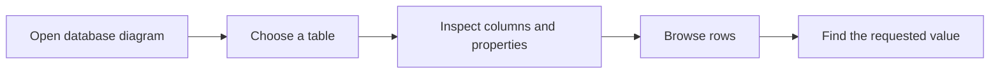

If you have not already done so, follow the setup steps above.

Then explore your database in DBeaver.

### Questions

1. What kinds of tables can you find?
2. Can you find how to view a diagram for your database?
3. Select the `task` table. What properties does it have?
4. What kind of data is stored in the table?
5. Can you explore the data directly in DBeaver?
6. What is the `title` value in row `18`?

---

# 7. Data Types

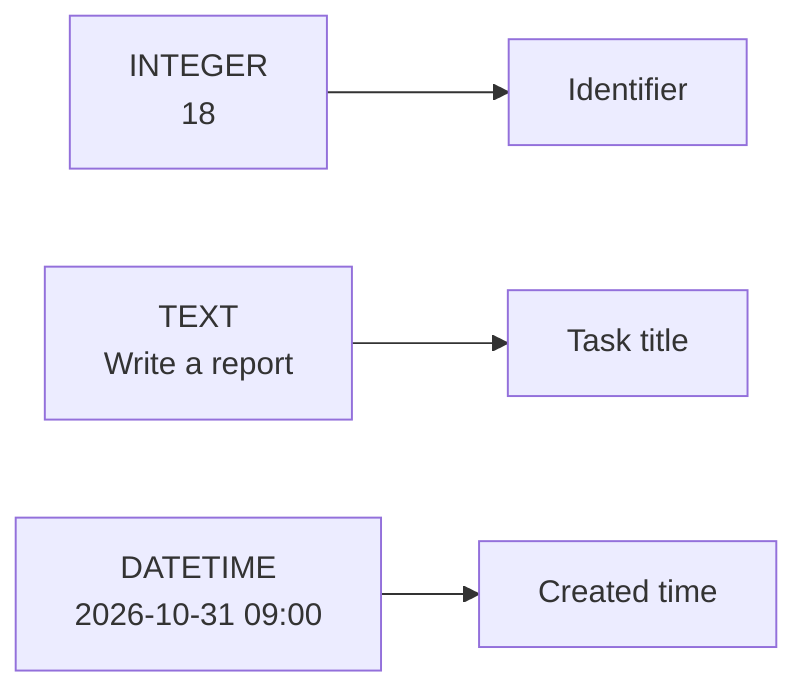

Open the properties of the `task` table.

You will see data types such as:

- `INTEGER`
- `TEXT`
- `DATETIME`

When creating a table, we define the type of data each column will hold.

This helps the database understand how to store and manage the data efficiently.

## Common Data Types

| Data Type | Description | Example Usage |
|---|---|---|
| `INTEGER` | Whole numbers | IDs, counts, ages |
| `REAL` | Decimal numbers | Prices, measurements |
| `TEXT` | Text strings | Names, descriptions, emails |
| `BOOLEAN` | True/False values | Flags, status indicators |
| `DATE` | Date values | Dates |
| `TIME` | Time values | Times |
| `DATETIME` | Date and time | Timestamps |
| `BLOB` | Binary data | Images, files |

> **Note:** You do not need to memorize every data type. Keep in mind that you can always refer to cheat sheets and documentation when you are unsure.

---

# 8. Interacting With Your Database

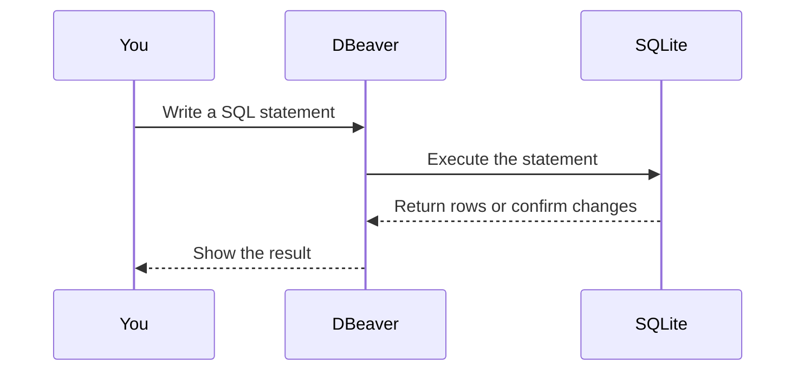

Now that the database is set up, learn how to interact with it using **SQL (Structured Query Language)**.

## What is SQL?

SQL is a specialized language for managing and manipulating data in relational database management systems.

Unlike general-purpose languages such as JavaScript or Python, SQL focuses specifically on data operations.

### Key Characteristics

- **Declarative** — You describe what data you want rather than exactly how to retrieve it.
- **Standardized** — Core SQL concepts are standardized, although database systems have their own variations.
- **Powerful** — Complex data operations can often be expressed in a few lines.
- **Widely used** — SQL is fundamental to many applications and systems.

## CRUD Operations

The four fundamental database operations are:

| Operation | SQL | Purpose |
|---|---|---|
| Create | `INSERT` | Add data |
| Read | `SELECT` | Retrieve data |
| Update | `UPDATE` | Modify data |
| Delete | `DELETE` | Remove data |

These are commonly referred to as **CRUD**:

> **Create, Read, Update, Delete**

---

# 9. SELECT — Retrieving Data

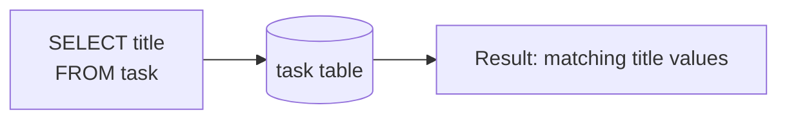

The `SELECT` statement is used to retrieve data from one or more tables.

It is one of the most common SQL operations.

## Basic Syntax

```sql
SELECT column1, column2
FROM table_name;
```

To retrieve all columns:

```sql
SELECT *
FROM table_name;
```

---

# 10. WHERE — Filtering Data

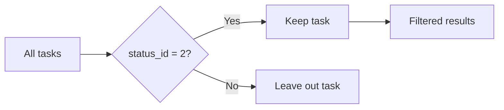

The `WHERE` clause filters records based on conditions.

## Basic Syntax

```sql
SELECT column1, column2
FROM table_name
WHERE condition;
```

Example:

```sql
SELECT *
FROM task
WHERE status_id = 2;
```

---

# 11. ORDER BY — Sorting Data

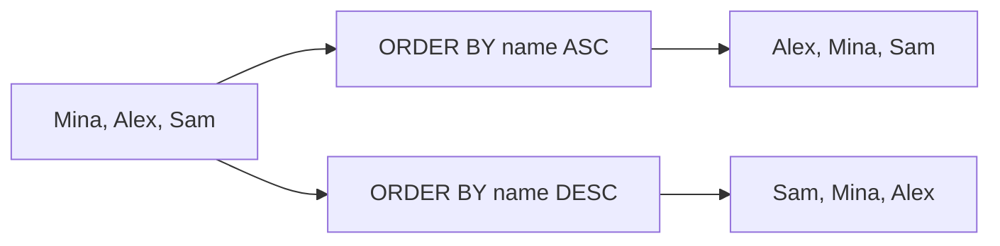

The `ORDER BY` clause sorts query results.

### Ascending

```sql
SELECT *
FROM user
ORDER BY name ASC;
```

### Descending

```sql
SELECT *
FROM user
ORDER BY name DESC;
```

---

# Exercise 2 — Practice SELECT Queries

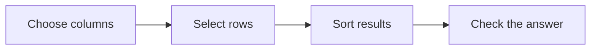

Now that the database is set up, practice writing SQL queries.

1. List the names and phones of all users.
2. List all users, ordering them alphabetically by name.
3. Find the name of the user with `id = 10`.
4. Find the 3 oldest tasks based on creation date.

> **Note:** For more practice, refer back to the SQL cheat sheet and experiment with more complex queries.

---

# 12. INSERT — Adding Data

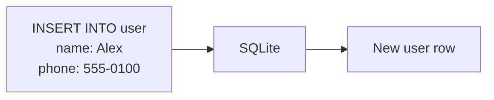

The `INSERT` statement adds new records to a table.

## Basic Syntax

```sql
INSERT INTO table_name (column1, column2)
VALUES (value1, value2);
```

Example:

```sql
INSERT INTO user (name, phone)
VALUES ('John Doe', '12345678');
```

---

# 13. UPDATE — Modifying Data

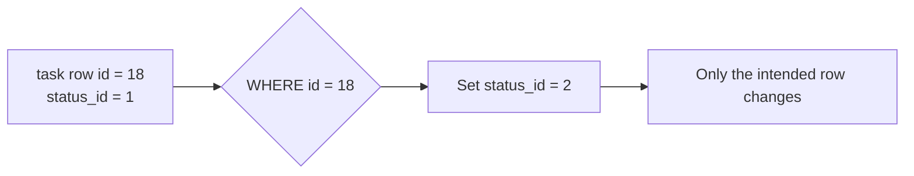

The `UPDATE` statement modifies existing records.

## Basic Syntax

```sql
UPDATE table_name
SET column1 = value1
WHERE condition;
```

Example:

```sql
UPDATE task
SET status_id = 2
WHERE id = 18;
```

> **Important:** Always include a `WHERE` clause with `UPDATE` statements.
>
> Otherwise, you may accidentally update **every row** in the table.

---

# 14. DELETE — Removing Data

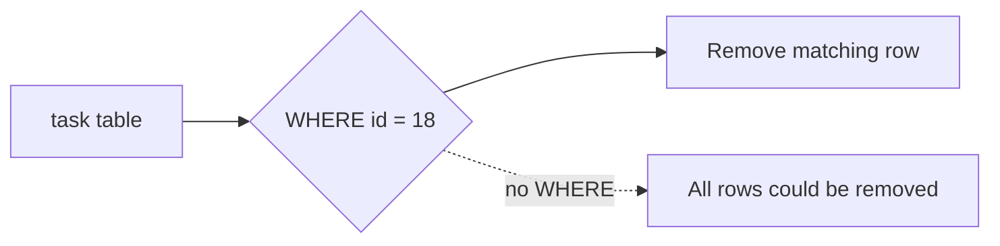

The `DELETE` statement removes records.

## Basic Syntax

```sql
DELETE FROM table_name
WHERE condition;
```

Example:

```sql
DELETE FROM task
WHERE id = 18;
```

> **Important:** The same warning applies to `DELETE`.
>
> Always make sure you have a `WHERE` clause when you intend to delete specific records.

---

# 15. Interactive Practice

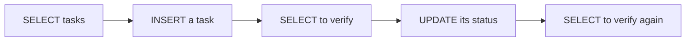

Practice the CRUD operations together.

## 1. Retrieve all tasks

```sql
SELECT *
FROM task;
```

## 2. Add a new task

```sql
INSERT INTO task (...)
VALUES (...);
```

## 3. Verify the task was added

```sql
SELECT *
FROM task
WHERE ...;
```

## 4. Update the task status

```sql
UPDATE task
SET status_id = 2
WHERE ...;
```

## 5. Verify that the update worked

```sql
SELECT *
FROM task
WHERE ...;
```

---

# Exercise 3 — Combine Everything

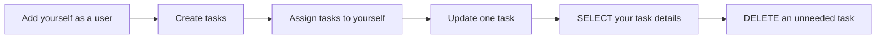

Use the SQL operations you have learned.

## Tasks

1. Add yourself as a new user in the `user` table.
2. Create **2 or more tasks** assigned to yourself.
3. Update one of the tasks you created so its status is:

```text
In Progress
```

using:

```text
status_id = 2
```

4. Retrieve only the `title` and `description` of all tasks assigned to you.
5. Delete a task that you no longer need.

---

# Key Takeaways

By the end of this session, you should understand:

- What a database is.
- Why applications use databases.
- What a DBMS is.
- The difference between a database and a DBMS.
- Basic relational database terminology.
- Tables, rows, and columns.
- Primary keys and foreign keys.
- Common database data types.
- What SQL is.
- The four CRUD operations:
  - `SELECT`
  - `INSERT`
  - `UPDATE`
  - `DELETE`
- How to filter data with `WHERE`.
- How to sort data with `ORDER BY`.
- How to work with a SQLite database using DBeaver.

## Safety Rules to Remember

### `UPDATE`

Always ask yourself:

> "Which rows am I changing?"

Before running:

```sql
UPDATE ...
```

make sure the `WHERE` clause targets exactly the rows you intend to change.

### `DELETE`

Always ask yourself:

> "Which rows am I deleting?"

Before running:

```sql
DELETE ...
```

make sure the `WHERE` clause targets exactly the rows you intend to delete.

---

## Source

HackYourFuture Program — Foundation / Databases / Week 1 / Session Plan

https://program.hackyourfuture.dk/course-content/foundation/databases/week1/session-plan
