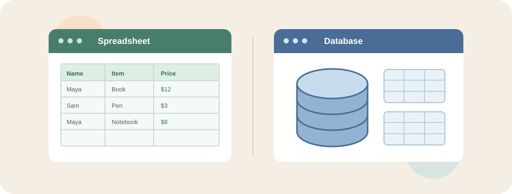
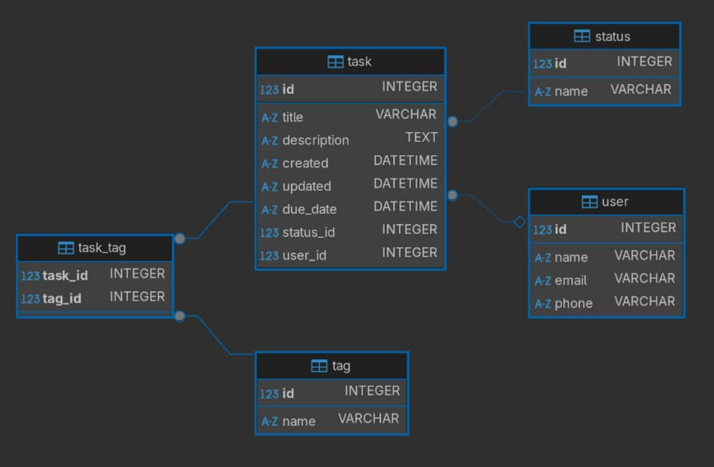
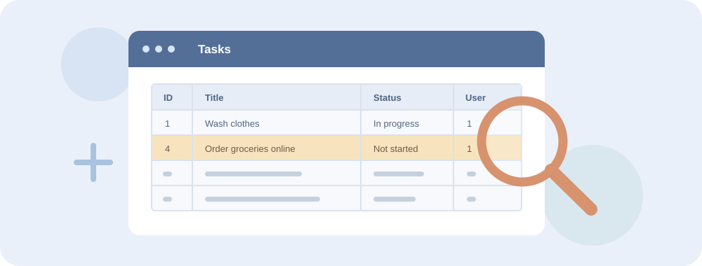

# Databases — Week 1 Session Plan

> Adapted from the HackYourFuture Foundation Databases Week 1 session plan:
> https://program.hackyourfuture.dk/course-content/foundation/databases/week1/session-plan

## Session Materials

- **[Database Diagram](session-materials/database-diagram.jpg)** — The diagram of the database to be created in this session.
- **[Sample Tasks database](session-materials/tasks.sqlite3)** — A pre-created database to use for all exercises.
- **[Sample SQL file](session-materials/session-data.sql)** — The SQL script that creates the tables and fills them with example data.

**Before the session:** Install DBeaver and download the [sample Tasks database](session-materials/tasks.sqlite3) to a folder you can find again, such as `Documents/databases`. On GitHub, open the file link and use **Download raw file** to save it; make sure the saved file is named `tasks.sqlite3`. Use this downloaded copy for all exercises. During the session, you will also create a separate database with the sample SQL file as a demonstration; you will not use that second database for exercises.

> **No coding experience needed.** This session starts from zero. Every new word is explained the first time it appears, and there is a [Glossary](#glossary) at the end.

## Session Outline

1. [Introduction to Databases](#1-introduction-to-databases)
   - [**1.1** What is a database?](#11-what-is-a-database)
   - [**1.2** Real-life examples](#12-real-life-examples)
   - [**1.3** Benefits of using a database](#13-what-do-we-gain-from-using-a-database)
   - [**1.4** Spreadsheets vs. databases](#14-spreadsheets-vs-databases)
   - [**1.5** Databases in software architecture](#15-databases-in-software-architecture)
   - [**1.6** Database vs. Database Management System](#16-database-vs-database-management-system)
   - [**1.7** Popular DBMS options](#17-popular-dbms-options)
2. [Connecting to and Creating Databases](#2-connecting-to-and-creating-databases)
   - [**2.1** Install DBeaver](#21-install-dbeaver)
   - [**2.2** Connect to the downloaded Tasks database](#22-connect-to-the-downloaded-tasks-database)
   - [**2.3** Understand database structure](#23-understanding-database-structure)
   - [**2.4** Create a separate database and insert sample data](#24-create-a-separate-database-and-insert-sample-data)
   - [**2.5** Explore the downloaded database](#25-exercise--explore-the-database)
   - [**2.6** Understand data types](#26-data-types)
3. [Interacting With Your Database](#3-interacting-with-your-database)
   - [**3.1** Introduction to SQL and CRUD](#31-what-is-sql)
   - [**3.2** Write and run SQL in DBeaver](#32-writing-and-running-sql-in-dbeaver)
   - [**3.3** Retrieve data with `SELECT`](#33-select--retrieving-data)
   - [**3.4** Filter data with `WHERE`](#34-where--filtering-data)
   - [**3.5** Sort data with `ORDER BY`](#35-order-by--sorting-data)
   - [**3.6** Limit results with `LIMIT`](#36-limit--limiting-results)
   - [**3.7** Practice `SELECT` queries](#37-exercise--practice-select-queries)
   - [**3.8** Add data with `INSERT`](#38-insert--adding-data)
   - [**3.9** Modify data with `UPDATE`](#39-update--modifying-data)
   - [**3.10** Remove data with `DELETE`](#310-delete--removing-data)
   - [**3.11** Create a table with `CREATE TABLE`](#311-create-a-table-with-create-table)
   - [**3.12** Interactive CRUD practice](#312-interactive-practice)
   - [**3.13** Combine the SQL operations](#313-exercise--combine-everything)
   - [**3.14** Review key takeaways](#314-key-takeaways)
   - [**3.15** Follow safe data-change practices](#315-safety-rules-to-remember)
4. [Glossary](#glossary)
5. [Additional Tools and Resources](#additional-tools-and-resources)

---

# 1. Introduction to Databases

This chapter introduces databases as a practical way to organize and manage information. You will look at familiar examples, see why applications depend on databases, and learn how a database differs from the software that manages it.


*Photo: [Unsplash License](https://unsplash.com/license)*

## 1.1 What is a database?

**Data** is simply recorded information: a name, a phone number, a price, a date, a photo.

A **database** is an organized collection of structured information, or data, typically stored electronically in a computer system.

Think of it as a digital filing cabinet where you can store, retrieve, and manage information efficiently.

"Structured" means that every piece of information has a fixed place. In a contact list, for example, every contact has a *name* field, a *phone* field, and an *email* field. Because the structure is predictable, the computer can quickly answer questions such as *"Which contacts live in Copenhagen?"*

## 1.2 Real-Life Examples

### Personal Use

- **Contact List:** Your phone's contact list is a simple database storing names, phone numbers, and email addresses.
- **Photo Library:** Your phone's photo app is a database organizing images by date, location, or album.
- **Excel Spreadsheets:** When you track monthly expenses or create a shopping list, you're essentially using a simple database.

### Business Use

- **Inventory Management:** Stores use databases to track products, quantities, and prices.
- **Customer Records:** Businesses maintain customer information, purchase history, and preferences.
- **Employee Management:** Companies store employee details, attendance, and payroll information.

### Everyday Services

- **Banking Systems:** Banks use databases to track account balances, transactions, and personal information.
- **Social Media:** Platforms such as Facebook and Instagram store user profiles, posts, and connections.
- **Online Shopping:** E-commerce sites use databases to manage product catalogs, customer orders, and shipping information.


> **Discussion:** Which apps did you use today? What information do you think they stored about you?

## 1.3 What Do We Gain from Using a Database?

1. **Organization** — Information is structured and easy to find.
2. **Efficiency** — Data can be accessed quickly.
3. **Data Integrity** — Databases help maintain accurate and consistent data.
4. **Security** — Access to sensitive data can be controlled.
5. **Scalability** — Databases can handle growing amounts of data efficiently.
6. **Reliability** — Data can be protected from loss or corruption.
7. **Shareability** — Multiple users can access the same data.

> Think of a database as a well-organized digital library where you can store and retrieve information quickly and efficiently, like a filing cabinet or spreadsheet, but with much more power and flexibility.

---

## 1.4 Spreadsheets vs. Databases

Many people already use spreadsheets (Excel, Google Sheets), and a database table looks very similar: rows and columns. So why not just use a spreadsheet?



| | Spreadsheet | Database |
|---|---|---|
| **Best for** | Small lists, quick calculations, one person | Large amounts of data used by apps and many people |
| **Rules for data** | Cells are usually easy to edit freely | Tables can define rules such as "cannot be empty"; how strictly types are checked depends on the database |
| **Size** | Becomes slow with hundreds of thousands of rows | Handles millions of rows |
| **Many users at once** | Easy to overwrite each other's changes | Designed for many simultaneous users and apps |
| **Linking information** | Copying the same data into several sheets | Tables are linked using keys, so each fact is stored once |
| **How you ask questions** | Filters, formulas, scrolling | A query language called **SQL** |

**Example:** If a customer changes their email address, a spreadsheet might have that email copied into the *Customers*, *Orders*, and *Invoices* sheets — and you must remember to change all three. In a database, the email is stored once in the customer table, and everything else *points* to that customer.

---

## 1.5 Databases in Software Architecture

Databases are one part of a larger application: the application uses them to save information and retrieve it when needed. These examples show how the same role appears across different kinds of software.

In modern software applications, databases serve as the backbone of data storage and management.

A simple way to picture it:

```text
You (the user)  →  App or website  →  Database
   "Show my        "Find orders       Looks up the
    orders"         for user 42"      matching rows
```

The app asks the database a question, the database returns the answer, and the app shows it to you in a nice layout.

### Recipe website

Imagine a recipe website where users can share their favorite dishes.

The database can store:

- Recipes
- User profiles
- Comments
- Ratings

When someone searches for `"chocolate cake"`, the application queries the database to find relevant recipes.

### Movie streaming platform

A movie streaming platform can use databases to store:

- Movies
- User watchlists
- Viewing history
- User preferences

When a user logs in, the application retrieves their preferences and watch history.

### Blog

Even a simple blog needs a database to store:

- Articles
- Comments
- User information

Without a database, these applications would be like a library without a catalog: the information exists, but finding and managing it becomes difficult.

---

## 1.6 Database vs. Database Management System

A database stores the information; a Database Management System (DBMS) is the software used to create, query, update, and protect that information. The online-store example illustrates why the distinction matters.

> **Analogy:** The database is the *library's books*. The DBMS is the *librarian* who knows where every book is, who is allowed to borrow it, and makes sure nothing gets lost.

### Real-Life Example — Online Store


Imagine running an online store. You need to maintain data such as:

- Inventory
- Orders
- Customer information
- Order status
- Customer history

Now imagine that customer X places an order.

You may need to:

1. Update the inventory.
2. Check customer data.
3. Create or update the order.
4. Update the order status.
5. Update the customer's purchase history.
6. Send a confirmation.

An application can automate these steps using a **Database Management System (DBMS)** to store and update the records. The DBMS helps enforce the database's rules; the application decides what to do when a customer places an order.

### Without a DBMS

You might need to manually update separate spreadsheets for:

- Inventory
- Orders
- Customers

### With an application and a DBMS

When someone places an order, the **application** can ask the DBMS to update inventory, create an order record, and retrieve customer history. The application can then send a confirmation email using a separate email service. The DBMS manages the stored data; it does not send emails by itself.

## 1.7 Popular DBMS Options

There are two big families of databases:

- **Relational (SQL) databases** store data in tables made of rows and columns, and link tables together. You talk to them using **SQL**. *This is what we learn in this course.*
- **Non-relational (NoSQL) databases** store data in other shapes, such as documents that look like nested lists. They are useful when the structure of the data changes often.

| DBMS | Type | Often used for | Why |
|---|---|---|---|
| MySQL | Relational | Web applications, small-to-medium businesses | Free, reliable, widely supported |
| PostgreSQL | Relational | Complex applications, large datasets | Powerful features and complex query support |
| SQLite | Relational | Small applications, mobile apps, learning | Lightweight; the whole database is a single file and needs no setup |
| MongoDB | Non-relational | Applications with changing data structures | Flexible data model |

In this session we use **SQLite**, because the entire database lives in one file on your computer — there is no server to install or configure.

---

# 2. Connecting to and Creating Databases

In this chapter, you will set up a SQLite database and explore how its information is organized. You will use the provided Tasks example to connect database concepts—tables, rows, columns, keys, and data types—to a real structure you can inspect.

You will use the provided Tasks database as your playground for learning SQL. Later, you will create a separate database with a script to see how its tables and data are created, then return to the provided database for all exercises.

This will also allow us to explore:

- Tables
- Rows
- Columns
- Primary keys
- Foreign keys
- Data types
- SQL queries

## 2.1 Install DBeaver

**DBeaver** is a free program that lets you look at and work with databases through a visual interface. It is not a database itself — it is a *tool* that connects to a database, much like a web browser is a tool that connects to websites.

We use the free **DBeaver Community** edition.

### Download

1. Open the [official download page](https://dbeaver.io/download/) or use the direct download link for your computer:

| Your computer | Choose |
|---|---|
| Windows | [Windows installer](https://dbeaver.io/files/dbeaver-ce-latest-windows-x86_64.exe) |
| Mac with Apple chip (M1, M2, M3, …) | [macOS for Apple Silicon](https://dbeaver.io/files/dbeaver-ce-latest-macos-aarch64.dmg) |
| Mac with Intel chip | [macOS for Intel](https://dbeaver.io/files/dbeaver-ce-latest-macos-x86_64.dmg) |

> **Not sure which Mac you have?** Click the Apple menu → **About This Mac**. If it says **Chip: Apple M…**, choose Apple Silicon. If it says **Processor: Intel**, choose Intel.

The download is a few hundred megabytes, so it may take a few minutes.

### Install on Windows

1. Open your **Downloads** folder and double-click the file named like `dbeaver-ce-…-windows-x86_64.exe`.
2. If Windows asks *"Do you want to allow this app to make changes?"*, click **Yes**.
3. Choose your language and click **OK**, then **Next**.
4. Accept the license agreement.
5. When asked who to install for, choose **For me** (this does not require administrator rights).
6. Keep all default options and click **Next** → **Install**.
7. Click **Finish**. DBeaver will now appear in your **Start** menu.

### Install on macOS

1. Open your **Downloads** folder and double-click the file named like `dbeaver-ce-…-macos-aarch64.dmg` (Apple Silicon) or `…-macos-x86_64.dmg` (Intel).
2. In the window that opens, **drag the DBeaver icon into the Applications folder**.
3. Open **Applications** and double-click **DBeaver**.
4. If macOS says the app was downloaded from the internet, click **Open**.

### First Launch

The first time DBeaver opens:

- It may ask whether to **create a sample database**. Click **No** — we will use our own.
- It may show a **Tip of the Day** or a welcome window. You can close it.
- It may ask to choose a **workspace** folder. Accept the default.

You should now see the main DBeaver window. On the left is the **Database Navigator**, which lists your database connections. It will be empty for now.


---

## 2.2 Connect to the Downloaded Tasks Database

A **connection** tells DBeaver *where* a database is and *how* to talk to it. For SQLite, the database is a single file on your computer, so the connection simply points to that file.

Use the `tasks.sqlite3` file you downloaded in [Session Materials](#session-materials). It already has the example tables and rows. **Use this connection for all exercises in this session**, even after you create a separate database below.

Using DBeaver to open the downloaded file:

1. Click **New Database Connection** (the plug icon with a `+`) in the toolbar, or press `Ctrl+Shift+N` (`Cmd+Shift+N` on macOS).
2. Select **SQLite**.
3. Click **Next**.
4. In the **Path** field, click **Browse** and choose the `tasks.sqlite3` file you saved in `Documents/databases` (or wherever you downloaded it). Select the file itself, not just its folder.
5. Click **Test Connection** to verify that everything works.
   - The first time, DBeaver may say the **SQLite driver files are missing** and offer to download them. A *driver* is a small add-on that teaches DBeaver how to talk to a specific type of database. Click **Download** and wait.
   - You should then see **Connected**.
6. Click **Finish**.

Your new connection now appears in the **Database Navigator** on the left. Click the arrow next to it to expand it. You should see tables such as `user` and `task`. If there are no tables, check that you selected the downloaded file rather than an empty file with the same name.

> See the DBeaver documentation for more information about SQLite connections.

---

## 2.3 Understanding Database Structure

Before creating tables, understand the basic terminology.

### Database Terminology

| Term | Meaning |
|---|---|
| **Database** | The entire collection of related data |
| **Table** | A collection of related records |
| **Row / Record** | A single entry in a table |
| **Column / Field** | A specific piece of information in each row |
| **Primary Key** | A unique identifier for each row |
| **Foreign Key** | A reference to a primary key in another table |

A useful mental model is:

```text
Database
└── Tables (for example, user and task)
    ├── Columns describe each kind of information
    └── Rows hold one entry each

Primary keys identify rows; foreign keys link rows in different tables.
```

### Example: the `user` table

Here are a few rows from the `user` table in our sample database:

| id | name | email | phone |
|---|---|---|---|
| 1 | Aarika Ellingworth | aellingworth0@harvard.edu | 483-396-8795 |
| 2 | Pren Goldsworthy | pgoldsworthy1@spotify.com | 635-572-8467 |
| 3 | Pablo Kisbee | pkisbee2@lulu.com | 790-962-8683 |

- The whole grid is a **table**.
- Each horizontal line (one person) is a **row**.
- Each vertical heading (`id`, `name`, `email`, `phone`) is a **column**.
- `id` is the **primary key**: every user has a different number, even if two users have the same name. Think of it like a personal ID number.

### Example: linking tables with a foreign key

The `task` table stores to-do items. Instead of copying the user's name and email into every task, each task stores only the user's `id` in a column called `user_id`:

| id | title | status_id | user_id |
|---|---|---|---|
| 1 | Wash clothes | 2 | 1 |
| 4 | Order groceries online | 1 | 1 |

`user_id` is a **foreign key**: it points to `id` in the `user` table. Both tasks above belong to user `1`, Aarika Ellingworth. In the same way, `status_id` points to the `status` table, where `1` = *Not started*, `2` = *In progress*, and `3` = *Done*.



The diagram also shows `task_tag`, which links tasks to labels in the `tag` table. For example, task `1` (*Wash clothes*) has two rows in `task_tag`: one points to *Personal* (tag `2`), and the other to *Home* (tag `4`). One task can therefore have more than one tag without storing a list of tags inside the task row.

---

## 2.4 Create a Separate Database and Insert Sample Data

This demonstration shows how a script creates tables and fills them with sample data. It uses a second database, separate from the downloaded `tasks.sqlite3` that you will use for exercises.

1. Click **New Database Connection** (the plug icon with a `+`) in the toolbar, or press `Ctrl+Shift+N` (`Cmd+Shift+N` on macOS).
2. Select **SQLite** and click **Next**.
3. In the **Path** field, choose **Create** and create a new file named `my-tasks.sqlite3` in a folder you can find again, such as `Documents/databases` (create the folder first if needed). Do not select or overwrite an existing database.
4. Click **Test Connection**.
   - The first time, DBeaver may say the **SQLite driver files are missing** and offer to download them. A *driver* is a small add-on that teaches DBeaver how to talk to a specific type of database. Click **Download** and wait.
   - You should then see **Connected**. Click **Finish**.
5. In the Database Navigator, expand the new connection. It is empty: no sample tables have been created yet. Check the connection's path if you are unsure which file it uses.

Next, populate the empty database. A **SQL script** is a text file containing a list of SQL instructions. Running the script tells the database to perform each instruction in order — here, to create the tables and fill them with example data.

1. Open the [sample SQL file](session-materials/session-data.sql) on GitHub and copy its entire contents (or download it and open it in a text editor).
2. In DBeaver, right-click the connection to your **empty `my-tasks.sqlite3` database** and select **SQL Editor** → **New SQL Script**.
3. Paste the SQL commands into the editor. Check that the editor is connected to your empty `my-tasks.sqlite3` database, not `tasks.sqlite3`.
4. Execute the complete script using the **Execute SQL Script** button (the document icon with an orange triangle) or `Alt+X` (`Option+X` on macOS).
5. In the Database Navigator, right-click the `my-tasks.sqlite3` connection and select **Refresh** (or press `F5`). Expand **Tables** to see the new tables.

After execution, you should have the sample Tasks database with five tables:

| Table | What it stores |
|---|---|
| `user` | People who can be assigned tasks |
| `task` | To-do items, each with a status and an assigned user |
| `status` | The possible task statuses: *Not started*, *In progress*, *Done* |
| `tag` | Labels that can be attached to tasks |
| `task_tag` | Which tags are attached to which tasks |

This second database is only for the demonstration; continue using the downloaded `tasks.sqlite3` connection for all exercises. Run the setup script only once: if the tables already exist, running it again will cause errors. Do not run the script on `tasks.sqlite3`, which already contains these tables.

### Explore Your Database

Use the database diagram to understand the relationships between the tables. Each box is a table, and each line between boxes is a foreign-key relationship.

---

## 2.5 Exercise — Explore the Database

If you have not already connected to the downloaded database, follow [section 2.2](#22-connect-to-the-downloaded-tasks-database). The separate database demonstration is not needed for this exercise.

Then explore the downloaded `tasks.sqlite3` database in DBeaver.

> **How to look around:** Double-click a table in the Database Navigator. The **Properties** tab shows its columns and their data types. The **Data** tab shows its rows, like a spreadsheet. The **ER Diagram** tab shows how it links to other tables.

### Questions

1. What kinds of tables can you find?
2. Can you find how to view a diagram for your database?
3. Select the `task` table. What properties does it have?
4. What kind of data is stored in the table?
5. Can you explore the data directly in DBeaver?
6. What is the `title` of the task with `id = 18`? Find its `id` column in the **Data** tab; it is not necessarily the 18th row shown.

---

## 2.6 Data Types

Open the properties of the `task` table.

You will see data types such as:

- `INTEGER`
- `TEXT`
- `DATETIME`

When creating a table, we define the type of data each column will hold.

Types tell the database what kind of value is expected. Some databases strictly reject values of the wrong type, but SQLite is more flexible: declaring a column as `INTEGER` does not by itself guarantee that text will be rejected. Rules such as `NOT NULL` can require that a value be present.

### Common Data Types

| Data Type | Description | Example Usage |
|---|---|---|
| `INTEGER` | Whole numbers | IDs, counts, ages |
| `REAL` | Decimal numbers | Prices, measurements |
| `TEXT` | Text strings | Names, descriptions, emails |
| `BOOLEAN` | True/False values | Flags, status indicators |
| `DATE` | Date values | Dates |
| `TIME` | Time values | Times |
| `DATETIME` | Date and time | Timestamps |
| `BLOB` | Binary data | Images, files |

### Empty values: `NULL`

Sometimes a value is unknown or missing — for example, a task with no due date. Databases represent "no value" with a special marker called **`NULL`**. `NULL` is not zero and not an empty text; it means *"nothing here"*. In DBeaver, these cells show `[NULL]`.

Columns can be marked **NOT NULL**, meaning a value is required. In our sample database, every user **must** have a `name` and an `email`, but `phone` can be left empty.

> **SQLite detail:** SQLite is flexible about types. Internally it stores values as `INTEGER`, `REAL`, `TEXT`, `BLOB`, or `NULL`. In this sample database, dates use text such as `'2017-10-25 06:54:16'` (year-month-day, hours:minutes:seconds); true/false values are usually stored as `1`/`0`.

> **Note:** You do not need to memorize every data type. Keep in mind that you can always refer to cheat sheets and documentation when you are unsure.

---

# 3. Interacting With Your Database

With the sample database ready, this chapter focuses on using SQL to work with data and create a table. You will retrieve and sort records, then practice creating, changing, and deleting records while checking that each operation affects the intended data.


*Photo: [Unsplash License](https://unsplash.com/license)*

Now that the database is set up, learn how to interact with it using **SQL (Structured Query Language)**.

## 3.1 What is SQL?

SQL is a specialized language for managing and manipulating data in relational database management systems.

Unlike general-purpose languages such as JavaScript or Python, SQL focuses specifically on data operations.

SQL reads almost like an English sentence. For example:

```sql
SELECT name FROM user WHERE id = 3;
```

reads as: *"Show me the name from the user table where the id is 3."*

### Key Characteristics

- **Declarative** — You describe what data you want rather than exactly how to retrieve it.
- **Standardized** — Core SQL concepts are standardized, although database systems have their own variations.
- **Powerful** — Complex data operations can often be expressed in a few lines.
- **Widely used** — SQL is fundamental to many applications and systems.

### CRUD Operations

The four fundamental database operations are:

| Operation | SQL | Purpose |
|---|---|---|
| Create | `INSERT` | Add data |
| Read | `SELECT` | Retrieve data |
| Update | `UPDATE` | Modify data |
| Delete | `DELETE` | Remove data |

These are commonly referred to as **CRUD**:

> **Create, Read, Update, Delete**

---

## 3.2 Writing and Running SQL in DBeaver

### Open a SQL editor

1. In the Database Navigator, click your `tasks.sqlite3` connection.
2. Open **SQL Editor** → **New SQL script** (or press `Ctrl+]`, `Cmd+]` on macOS).
3. A blank editor opens. This is where you type SQL.


### Run a query


| To run… | Click | Shortcut |
|---|---|---|
| **The query your cursor is on** | Orange triangle ▶ | `Ctrl+Enter` (`Cmd+Enter` on macOS) |
| **Everything in the editor** | Document icon with triangle | `Alt+X` (`Option+X` on macOS) |

The results appear in a grid below the editor.

### Your first query: find one task

If you have not connected to the downloaded sample database yet, follow [section 2.2](#22-connect-to-the-downloaded-tasks-database) first. Then type this into the SQL editor and click the orange triangle (or press `Ctrl+Enter` / `Cmd+Enter`):

```sql
SELECT id, title
FROM task
WHERE id = 18;
```

In the grid below the editor, you should see **one row**:

| id | title |
|---|---|
| 18 | Learn how databases work |

`SELECT` asks to show data, `id` and `title` name the columns to show, `FROM task` chooses the table, and `WHERE id = 18` chooses the task with that ID. The query only reads data; it does not change the database.

> **Pause and check:** Can everyone see that row? If you see “no such table: task,” check that the SQL editor is connected to the populated sample database, not an empty one.

### SQL writing rules

- **End every query with a semicolon** `;`. It tells DBeaver where one query ends and the next begins.
- **Keywords are not case-sensitive.** `SELECT`, `select`, and `Select` all work. Writing keywords in CAPITALS is a common convention that makes queries easier to read.
- **Text values go in single quotes**: `'Wash clothes'`. Numbers do not: `18`.
- **Line breaks and spaces do not matter.** You can write a query on one line or across several lines.
- **Comments** start with `--`. The database ignores them, so you can use them as notes:

```sql
-- Show all users
SELECT * FROM user;
```

### When something goes wrong

If a query contains a mistake, DBeaver underlines it in red and shows an error message. Read the message — it usually says exactly what is wrong, such as a misspelled table name or a missing quote.


Common beginner mistakes:

- Forgetting the `;` at the end.
- Forgetting the closing quote: `'Wash clothes` instead of `'Wash clothes'`.
- Misspelling a table or column name: `users` instead of `user`.

> **Save your work:** Use **File** → **Save As** to save your queries as a `.sql` file, for example for homework.

---

## 3.3 SELECT — Retrieving Data

The `SELECT` statement is used to retrieve data from one or more tables.

It is one of the most common SQL operations. `SELECT` only *reads* data — it never changes anything, so it is always safe to experiment with.



### Basic Syntax

```sql
SELECT column1, column2
FROM table_name;
```

Example — show the name and email of every user:

```sql
SELECT name, email
FROM user;
```

To retrieve all columns, use `*`, which means *"every column"*:

```sql
SELECT *
FROM table_name;
```

---

## 3.4 WHERE — Filtering Data

The `WHERE` clause filters records based on conditions. Only rows where the condition is true are returned.

### Basic Syntax

```sql
SELECT column1, column2
FROM table_name
WHERE condition;
```

Example — show all tasks that are *In progress* (`status_id` 2):

```sql
SELECT *
FROM task
WHERE status_id = 2;
```

### Comparison Operators

| Operator | Meaning | Example |
|---|---|---|
| `=` | Equal to | `WHERE id = 3` |
| `!=` or `<>` | Not equal to | `WHERE status_id != 3` |
| `>` / `<` | Greater than / less than | `WHERE id > 10` |
| `>=` / `<=` | Greater / less than or equal to | `WHERE created >= '2017-10-01'` |
| `LIKE` | Matches a text pattern; `%` means *"anything"* | `WHERE title LIKE '%car%'` |
| `IS NULL` | Has no value | `WHERE due_date IS NULL` |
| `IS NOT NULL` | Has a value | `WHERE phone IS NOT NULL` |

> **Note:** To check for an empty value, use `IS NULL`, **not** `= NULL`.

### Combining Conditions

Use `AND` when **both** conditions must be true, and `OR` when **either** one is enough:

```sql
-- Tasks for user 1 that are not done yet
SELECT title
FROM task
WHERE user_id = 1 AND status_id != 3;
```

---

## 3.5 ORDER BY — Sorting Data

The `ORDER BY` clause sorts query results.

### Ascending

`ASC` sorts from A to Z, smallest to largest, or oldest to newest. It is the default.

```sql
SELECT *
FROM user
ORDER BY name ASC;
```

### Descending

`DESC` sorts from Z to A, largest to smallest, or newest to oldest.

```sql
SELECT *
FROM user
ORDER BY name DESC;
```

---

## 3.6 LIMIT — Limiting Results

`LIMIT` returns only the first *n* rows. Combined with `ORDER BY`, it answers questions such as *"What are the 5 newest tasks?"*

```sql
SELECT title, created
FROM task
ORDER BY created DESC
LIMIT 5;
```

> **Order matters:** write the parts of a query in this order: `SELECT` → `FROM` → `WHERE` → `ORDER BY` → `LIMIT`.

---

## 3.7 Exercise — Practice SELECT Queries

Now that the database is set up, practice writing SQL queries.

1. List the names and phones of all users.
2. List all users, ordering them alphabetically by name.
3. Find the name of the user with `id = 10`.
4. Find the 3 oldest tasks based on creation date.
5. **Bonus:** Find all tasks that have no description.
6. **Bonus:** Find all users whose email ends with `.com`.
7. List the titles of all tasks that are not started.
8. Find the tasks assigned to user `1` that are in progress.
9. Find tasks whose title contains `database`.
10. List the names of users who have no phone number.
11. Show the five newest tasks by creation date, including their titles and creation dates.
12. List tasks that are either not started or in progress, ordered by title.

> **Note:** For more practice, refer back to the SQL cheat sheet and experiment with more complex queries.

---

## 3.8 INSERT — Adding Data

The `INSERT` statement adds new records to a table.

### Basic Syntax

```sql
INSERT INTO table_name (column1, column2)
VALUES (value1, value2);
```

- The first list names the **columns** you are filling in.
- The second list gives the **values**, in the same order.
- You do not need to provide the `id`: SQLite automatically gives the new row the next available number.
- Columns marked **NOT NULL** (required) must be included.

Example:

```sql
INSERT INTO user (name, email, phone)
VALUES ('John Doe', 'john@example.com', '12345678');
```

To add a task, you must provide the required columns `title`, `created`, `updated`, and `status_id`. `datetime('now')` is a SQLite helper that fills in the current date and time:

```sql
INSERT INTO task (title, description, created, updated, status_id, user_id)
VALUES ('Learn SQL', 'Finish the week 1 exercises', datetime('now'), datetime('now'), 1, 1);
```

### Exercises — Practice INSERT

Write a separate `INSERT` for each task below. Include the required `title`, `created`, `updated`, and `status_id` columns; use `datetime('now')` for both timestamps. Use your own distinctive titles if you prefer. After each insert, use `SELECT` to find the new row and record its `id` and exercise number; you will need them for the next sections. If a title appears more than once, identify the row you just inserted by its highest `id`.

1. Add a task titled `Practice 1: Read SQL`, with status `1` and assigned to user `1`.
2. Add `Practice 2: Write queries`, with status `1` and a description of your choice.
3. Add `Practice 3: Review results`, with status `2` and assigned to user `1`.
4. Add `Practice 4: Plan a project`, with status `1` and a due date of `2030-12-31`.
5. Add `Practice 5: Check data`, with status `2` and a description of your choice.
6. Add `Practice 6: Finish practice`, with status `3`, leaving the optional description and user empty.

---

## 3.9 UPDATE — Modifying Data

The `UPDATE` statement modifies existing records.

### Basic Syntax

```sql
UPDATE table_name
SET column1 = value1
WHERE condition;
```

Example (for illustration only; task `18` is an original sample row):

```sql
UPDATE task
SET status_id = 2
WHERE id = 18;
```

> **Important:** Always include a `WHERE` clause with `UPDATE` statements.
>
> Otherwise, you may accidentally update **every row** in the table.

### Exercises — Practice UPDATE

Use the six task IDs you recorded in the INSERT exercises. Before each update, run a `SELECT` with the same `WHERE` clause to confirm that it selects only your intended task. Afterward, select it again to check the change. Do not update the original sample rows.

1. Change task 1's status to in progress.
2. Change task 2's description to `Write and test SELECT queries`.
3. Change task 3's title to `Practice 3: Review query results`.
4. Change task 4's due date to `2031-01-15`.
5. Set task 5's status to done and its `updated` timestamp to `datetime('now')` in the same statement.
6. Assign task 6 to user `1` by setting its `user_id`.

---

## 3.10 DELETE — Removing Data

The `DELETE` statement removes records.

### Basic Syntax

```sql
DELETE FROM table_name
WHERE condition;
```

Example (for illustration only; do not delete the original sample task `18`):

```sql
DELETE FROM task
WHERE id = 18;
```

> **Important:** The same warning applies to `DELETE`.
>
> Always make sure you have a `WHERE` clause when you intend to delete specific records.

> **There is no undo.** Unlike a document editor, a database does not have a recycle bin. Once a row is deleted, it is gone.

### Exercises — Practice DELETE

Delete only the six tasks you created in the INSERT exercises, using their recorded IDs. For each exercise, first run a `SELECT` with the same `WHERE` clause and confirm it finds the intended task. Then run the `DELETE` and repeat the `SELECT` to confirm no row remains. Do not delete the original sample rows.

1. Delete your task 1.
2. Delete your task 2.
3. Delete your task 3.
4. Delete your task 4.
5. Delete your task 5.
6. Delete your task 6.

---

## 3.11 Create a Table with CREATE TABLE

`CREATE TABLE` adds a new, empty table to the connected database. Unlike `INSERT`, which adds a row to an existing table, it defines the table and its columns.

In the SQL editor connected to your sample database, run:

```sql
CREATE TABLE practice_note (
    id INTEGER PRIMARY KEY,
    title TEXT NOT NULL,
    details TEXT
);
```

- `practice_note` is the new table's name.
- `id INTEGER PRIMARY KEY` gives each row a unique number. SQLite assigns one automatically when you leave it out of an insert.
- `title TEXT NOT NULL` stores text and requires a value.
- `details TEXT` stores optional text; if omitted, it is `NULL`.

Right-click the connection in the Database Navigator and select **Refresh**, then expand **Tables** to find `practice_note`. Double-click it to inspect its columns. It has no rows yet; run the following statements one at a time to add and see one:

```sql
INSERT INTO practice_note (title, details)
VALUES ('First note', 'Practising CREATE TABLE');
```

```sql
SELECT * FROM practice_note;
```

The result should contain one row with an automatically assigned `id`, the title `First note`, and its details. Creating a table changes your database. If you run `CREATE TABLE` again with the same name, SQLite reports that the table already exists; choose a different name and use it in the later statements instead. Do not remove an existing table to repeat the example.

---

## 3.12 Interactive Practice

Practice the CRUD operations together. Run each step and look at the result before moving on.

### Retrieve all tasks

```sql
SELECT *
FROM task;
```

### Add a new task

```sql
INSERT INTO task (title, created, updated, status_id, user_id)
VALUES ('Prepare presentation', datetime('now'), datetime('now'), 1, 1);
```

### Verify the task was added

```sql
SELECT *
FROM task
WHERE title = 'Prepare presentation';
```

Note the `id` of the new task in the result — you will use it in the next steps. If several tasks have this title, use the row with the highest `id` (your newest task).

### Update the task status

The examples below use `36` only to show what a complete SQL query looks like. **Replace `36` in every query with the `id` you just found.** Never run these queries with `36` unless it really is your new task's `id`.

```sql
UPDATE task
SET status_id = 2
WHERE id = 36;
```

### Verify that the update worked

```sql
SELECT *
FROM task
WHERE id = 36;
```

The `status_id` should now be `2` (*In progress*).

### Delete only the task you added

First use the same `SELECT` above to check that the `id` belongs to *your* task. Then delete it:

```sql
DELETE FROM task
WHERE id = 36;
```

Run the same `SELECT` once more. It should show **no rows**. If it still appears, check the `id` and whether DBeaver needs you to commit the change. Do not delete one of the original sample tasks.

---

## 3.13 Exercise — Combine Everything

Use the SQL operations you have learned.

### Tasks

1. Add yourself as a new user in the `user` table. Remember that `name` and `email` are required.
2. Find your new user's `id`.
3. Create **2 or more tasks** assigned to yourself (use your `id` as the `user_id`).
4. Update one of the tasks you created so its status is *In Progress*.

5. Retrieve only the `title` and `description` of all tasks assigned to you.
6. Delete a task that you no longer need.
7. Create a new table named `practice_book` with an `INTEGER PRIMARY KEY` called `id`, a required `TEXT` column called `title`, and an optional `TEXT` column called `author`. If that table already exists, choose another name and use it in the next step.
8. Insert a book into your new table, then use `SELECT` to check its `id`, `title`, and `author`. Refresh the Database Navigator and find the table.

---

## 3.14 Key Takeaways

By the end of this session, you should understand:

- What a database is.
- Why applications use databases.
- How a database differs from a spreadsheet.
- What a DBMS is.
- The difference between a database and a DBMS.
- Basic relational database terminology.
- Tables, rows, and columns.
- Primary keys and foreign keys.
- Common database data types and `NULL`.
- What SQL is.
- How to create a table with `CREATE TABLE`.
- The four CRUD operations:
  - `SELECT`
  - `INSERT`
  - `UPDATE`
  - `DELETE`
- How to filter data with `WHERE`.
- How to sort data with `ORDER BY` and limit results with `LIMIT`.
- How to install DBeaver and work with a SQLite database in it.

## 3.15 Safety Rules to Remember

### `UPDATE`

Always ask yourself:

> "Which rows am I changing?"

Before running:

```sql
UPDATE ...
```

make sure the `WHERE` clause targets exactly the rows you intend to change.

### `DELETE`

Always ask yourself:

> "Which rows am I deleting?"

Before running:

```sql
DELETE ...
```

make sure the `WHERE` clause targets exactly the rows you intend to delete.

### Check first with `SELECT`

A safe habit: before an `UPDATE` or `DELETE`, run a `SELECT` with the **same** `WHERE` clause. The rows it returns are exactly the rows that will be changed or deleted. This example is for illustration only; use the ID of a task you created rather than deleting the original sample task `18`.

```sql
-- 1. Check which rows match
SELECT * FROM task WHERE id = 18;

-- 2. Only then delete them
DELETE FROM task WHERE id = 18;
```

---

# Glossary

| Term | Meaning |
|---|---|
| **Column / Field** | One kind of information stored for every row, such as `name` or `email`. |
| **Connection** | The settings that tell a tool such as DBeaver where a database is and how to reach it. |
| **CRUD** | Create, Read, Update, Delete — the four basic things you do with data. |
| **Data** | Recorded information, such as names, numbers, dates, or images. |
| **Data type** | The kind of value a column holds, such as a number, text, or date. |
| **Database** | An organized collection of structured data. |
| **DBeaver** | A free desktop program for viewing and working with databases. |
| **DBMS** | Database Management System — the software that stores, protects, and manages a database. |
| **Driver** | A small add-on that lets a tool talk to a specific type of database. |
| **Foreign key** | A column that points to the primary key of a row in another table. |
| **NULL** | A special marker meaning "no value". |
| **Primary key** | A column whose value is unique for each row, used to identify it. |
| **Query** | A question or instruction sent to the database, written in SQL. |
| **Relational database** | A database that stores data in linked tables. |
| **Row / Record** | One entry in a table, such as one user or one task. |
| **SQL** | Structured Query Language — the language used to work with relational databases. |
| **SQL script** | A file containing one or more SQL statements to run in order. |
| **SQLite** | A lightweight relational database stored in a single file. |
| **Table** | A set of rows and columns holding one kind of thing, such as users or tasks. |

---

# Additional Tools and Resources

## Optional: Use the Database from Visual Studio Code

This section is **optional** and intended for people who already use Visual Studio Code (VS Code). Everything in this session can be done in DBeaver alone.

DBeaver is a standalone desktop application; it does not run inside VS Code. However, because a SQLite database is just a file, you can open the **same** `tasks.sqlite3` file from VS Code using the free **SQLTools** extensions.

1. Install [Node.js](https://nodejs.org/) (the **LTS** version) if it is not already installed. The SQLite extension needs it to run.
2. In VS Code, open the **Extensions** view (`Ctrl+Shift+X`, or `Cmd+Shift+X` on macOS).
3. Search for and install **SQLTools SQLite** (publisher: *mtxr*). This also installs the main **SQLTools** extension.
4. Click the **SQLTools** icon (a database cylinder) in the left sidebar.
5. Hover over **CONNECTIONS** and click **Add New Connection**. Choose **SQLite**.
6. Give the connection a name (for example `Tasks`), and select your `tasks.sqlite3` file in the **Database file** field. Click **Save Connection**, then **Connect Now**.
7. If asked to install the `sqlite3` package, click **Install now** and wait for it to finish.
8. A new SQL editor opens. Write a query such as `SELECT * FROM user;` and click **Run on active connection** (or press `Ctrl+E Ctrl+E` / `Cmd+E Cmd+E`). The results appear in a new tab.

> If SQLTools reports that it cannot find Node.js, open VS Code settings, search for `sqltools.useNodeRuntime`, and set it to `true`. See the [SQLTools SQLite guide](https://github.com/mtxr/vscode-sqltools/blob/dev/docs/src/pages/en/drivers/sq-lite.mdx) for details.

> **Tip:** Close the connection in one tool before changing data in the other. SQLite allows only one program to write to the file at a time.

## Source

HackYourFuture Program — Foundation / Databases / Week 1 / Session Plan

https://program.hackyourfuture.dk/course-content/foundation/databases/week1/session-plan
